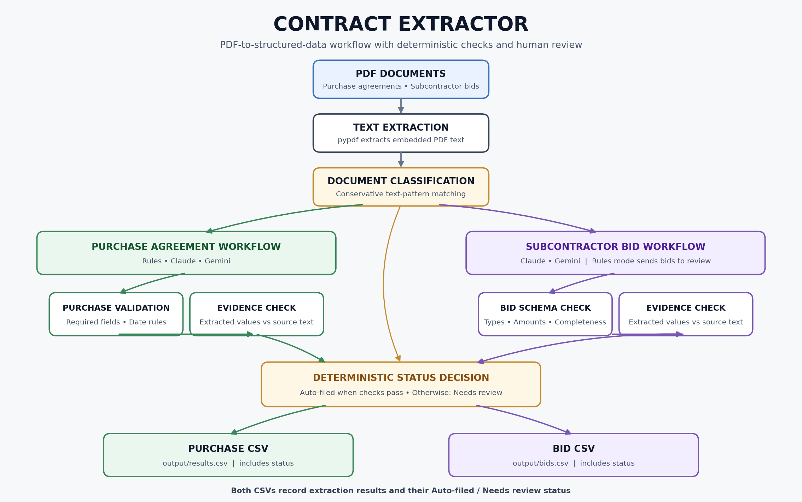

# Contract Extractor

A Python document-processing pipeline that extracts structured data from PDF documents across two workflows:

- **Real-estate purchase agreements**
- **Subcontractor construction bids**

The pipeline combines document classification, AI-assisted extraction, deterministic validation, and source-evidence checks. It produces separate CSV outputs and routes incomplete, ambiguous, invalid, or unsupported records to human review rather than automatically filing uncertain information.

**Core principle:** AI extracts. Deterministic checks verify. Humans resolve uncertainty.

## Portfolio demonstration

Explore the [complete demonstration](./demo/README.md), including fictional source PDFs and curated extraction results.

The demonstration contains seven documents across two workflows:

| Document type | Auto-filed | Needs review |
|---|---:|---:|
| Purchase agreements | 1 | 2 |
| Subcontractor bids | 2 | 2 |
| **Total** | **3** | **4** |

The examples demonstrate successful extraction as well as missing information, conflicting bid amounts, and unresolved commercial terms.

**[View demonstration files](./demo/)**

## System architecture

The following diagram illustrates the complete extraction workflow, from PDF input through validation and final CSV output.



## How it works

```text
PDF
 |
 v
Extract text with pypdf
 |
 v
Classify document
 |
 +---------------------------+
 |                           |
 v                           v
Purchase agreement       Subcontractor bid
 |                           |
 v                           v
Rules / Claude / Gemini  Claude / Gemini
 |                           |
 v                           v
Purchase validation      Bid validation
 |                           |
 v                           v
Evidence verification    Evidence verification
 |                           |
 +-------------+-------------+
               |
               v
        Auto-file or review
               |
        +------+------+
        |             |
        v             v
  output/results.csv  output/bids.csv
```

## Features

### Purchase-agreement extraction

Extracts:

- Seller and buyer
- Parcel ID
- Purchase price
- Effective date
- Due-diligence deadline
- Closing date
- Contingencies

Available extractors:

- Rule-based extraction
- Claude
- Gemini

### Subcontractor-bid extraction

Extracts:

- Project and contractor names
- Contact name and email
- Trade
- Base bid amount and currency
- Alternates and allowances
- Inclusions and exclusions
- Proposed duration
- Quote-validity date
- Payment terms
- Clarifications

Available extractors:

- Claude
- Gemini

The rule-based extractor does not extract bid details. Bid documents processed in rules mode are sent for review.

### Validation and evidence checks

The project separates AI extraction from deterministic checks.

- Required fields and data formats are validated.
- Bid amounts, currency, dates, durations, and structured lists are checked.
- Extracted values must have supporting evidence where evidence checking applies.
- Evidence quotes must appear in the source document and support the extracted value.
- Calculated purchase-agreement dates are sent for human review.
- Ambiguous or conflicting bid totals are sent for human review.
- Incomplete bids are sent for review when contact details, duration, quote validity, or usable payment terms are missing.
- Unknown document types are not guessed.

These checks reduce unsupported extraction, but they do not guarantee that every semantic interpretation is correct. Human review remains important.

## Requirements

Install the dependencies:

```powershell
pip install requests pypdf reportlab
```

`reportlab` is used to generate the fictional sample PDFs.

## Sample documents

Generate the purchase-agreement samples:

```powershell
python make_samples.py
```

Generate the subcontractor-bid samples:

```powershell
python make_bid_samples.py
```

The generated documents are fictional test data.

## Running the project

### 1. Rule-based purchase extraction

```powershell
python run.py
```

This uses the default `sample_contracts` directory and writes:

```text
output/results.csv
```

Subcontractor bids encountered in rules mode are routed to review because the rule-based extractor does not support bid extraction.

### 2. Claude extraction

Set your API key in PowerShell:

```powershell
$env:ANTHROPIC_API_KEY = "your-api-key"
```

Run:

```powershell
python run.py --extractor llm
```

Claude is used for both purchase agreements and subcontractor bids.

### 3. Gemini extraction

Set your API key:

```powershell
$env:GEMINI_API_KEY = "your-api-key"
```

Run:

```powershell
python run.py --extractor gemini
```

Gemini is used for both document types.

### 4. Process subcontractor bids only

```powershell
python run.py --extractor gemini --pdf-dir .\sample_bids
```

This writes the bid results to:

```text
output/bids.csv
```

### 5. Run the offline tests

```powershell
python -m unittest discover -s tests -v
```

The tests use mocked model responses where appropriate, so they do not require live API calls.

## Command-line options

| Option | Purpose |
|---|---|
| `--extractor rules` | Rule-based purchase extraction |
| `--extractor llm` | Claude extraction |
| `--extractor gemini` | Gemini extraction |
| `--pdf-dir PATH` | Select the directory containing PDFs |
| `--out PATH` | Set the purchase-agreement CSV path |
| `--bid-out PATH` | Set the subcontractor-bid CSV path |
| `--airtable` | Push purchase-agreement rows to Airtable |

View all options:

```powershell
python run.py --help
```

Purchase agreements and bids are written to separate CSV files because they have different schemas.

## Optional Airtable integration

The existing Airtable integration supports purchase-agreement rows only.

Configure these PowerShell environment variables:

```powershell
$env:AIRTABLE_TOKEN = "your-token"
$env:AIRTABLE_BASE_ID = "your-base-id"
$env:AIRTABLE_TABLE = "your-table-name"
```

Then run:

```powershell
python run.py --airtable
```

The Airtable table's field names must match the purchase CSV columns.

Bid rows are not sent to Airtable because the existing Airtable schema is purchase-specific.

## Model comparison

The project also includes a Gemini model comparison utility for the fictional purchase-agreement samples.

Example:

```powershell
python compare_models.py gemini-3.5-flash gemini-3.1-flash-lite
```

This makes live API calls and requires `GEMINI_API_KEY`.

It is a small smoke comparison using three documents, not a statistically meaningful accuracy benchmark.

## Project structure

```text
contract_extractor/
|
|-- run.py
|-- extractors.py
|-- bid_extractors.py
|-- bid_schema.py
|-- classification.py
|-- validate.py
|-- evidence.py
|-- sinks.py
|-- compare_models.py
|
|-- make_samples.py
|-- make_bid_samples.py
|
|-- sample_contracts/
|-- sample_bids/
|
|-- tests/
|-- output/
|
|-- README.md
```

## Current limitations

- Scanned PDFs without an embedded text layer are not processed through OCR.
- Document classification uses conservative text patterns and may send unfamiliar documents to review.
- Evidence verification uses deterministic text checks. It cannot fully establish whether every extracted statement has been interpreted correctly.
- Calculated dates and ambiguous commercial terms require human judgment.
- The sample documents are fictional and do not establish production accuracy.
- Airtable currently supports purchase agreements, not subcontractor bids.

## Design principle

**AI reads the document; deterministic code checks the result; a human handles uncertainty.**

The goal is not to automate every decision. It is to automate the reliable parts while making uncertain or unsupported information visible before it enters a business workflow.
